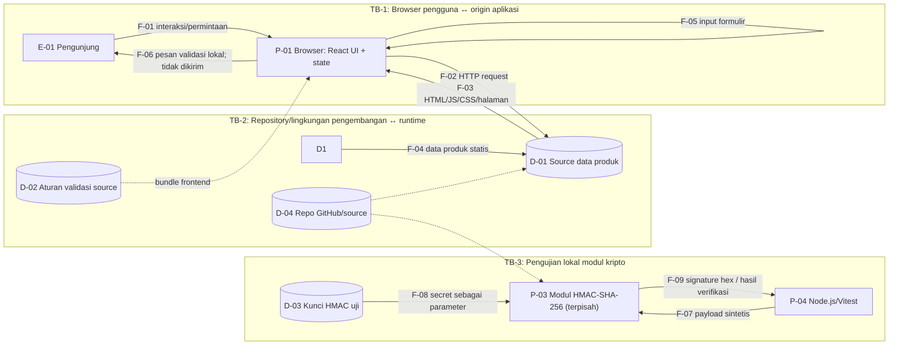

# DFD — MTM Solusindo
Versi: sec-0.1 (draft). Diagram memisahkan runtime katalog dari pengujian HMAC lokal.

## Elemen
| ID | Jenis | Deskripsi | Aset |
|---|---|---|---|
| E-01 | Entitas eksternal | Pengunjung | A-02, A-03 |
| P-01 | Proses | Browser menjalankan UI dan state formulir | A-03, A-04, A-05 |
| P-02 | Proses | Next.js menyajikan halaman/aset | A-01, A-05, A-08 |
| D-01 | Penyimpanan logis | Data produk statis di source | A-01, A-02 |
| D-02 | Penyimpanan logis | Aturan validasi di source | A-01, A-04 |
| P-03 | Proses non-runtime katalog | Fungsi HMAC create/verify | A-06, A-07 |
| P-04 | Proses | Runner Node.js/Vitest | A-06, A-08 |
| D-03 | Data store konseptual | Kunci uji dipasok sebagai parameter, bukan disimpan sebagai secret produksi | A-07 |
| D-04 | Penyimpanan | Repository source/dokumentasi | A-01, A-09 |

## Aliran
| ID | Aliran | Data dan proteksi |
|---|---|---|
| F-01 | Pengunjung → browser | Permintaan dan interaksi; input pengguna tidak tepercaya. |
| F-02 | Browser → Next.js | HTTP request halaman/aset; gunakan HTTPS saat deployment publik. |
| F-03 | Next.js → browser | HTML/JS/CSS dan konten halaman; tidak termasuk data formulir. |
| F-04 | Next.js → D-01 | Data produk statis; belum diverifikasi HMAC saat runtime. |
| F-05 | Pengguna → state browser | Nama/email/perusahaan/kategori/pesan; hanya state lokal. |
| F-06 | Browser → pengguna | Error atau “validasi berhasil”; bukan bukti pengajuan server. |
| F-07 | Runner → HMAC | Payload sintetis untuk tes lokal. |
| F-08 | Kunci uji → HMAC | Secret diberikan sebagai parameter; jangan commit secret produksi. |
| F-09 | HMAC → runner | HMAC hex 64 karakter atau true/false. HMAC bukan enkripsi. |

## Trust boundary dan status kriptografi
- **TB-1:** pengguna mengontrol browser dan input; validasi client-side dapat dilewati. Saat ini tidak ada backend yang menerima form.
- **TB-2:** source/repo dan build memengaruhi konten runtime; perubahan tidak sah dapat mengubah katalog.
- **TB-3:** modul HMAC berjalan melalui tes lokal, bukan alur katalog yang sedang berjalan.
- **D-01/A-02 ditandai target perlindungan HMAC**, tetapi belum terintegrasi runtime. Jangan mengklaim katalog saat ini sudah mendapat proteksi tersebut.
- Di luar cakupan: database, API form, autentikasi, pembayaran, dan penyimpanan cloud karena tidak ada di implementasi yang diperiksa.
