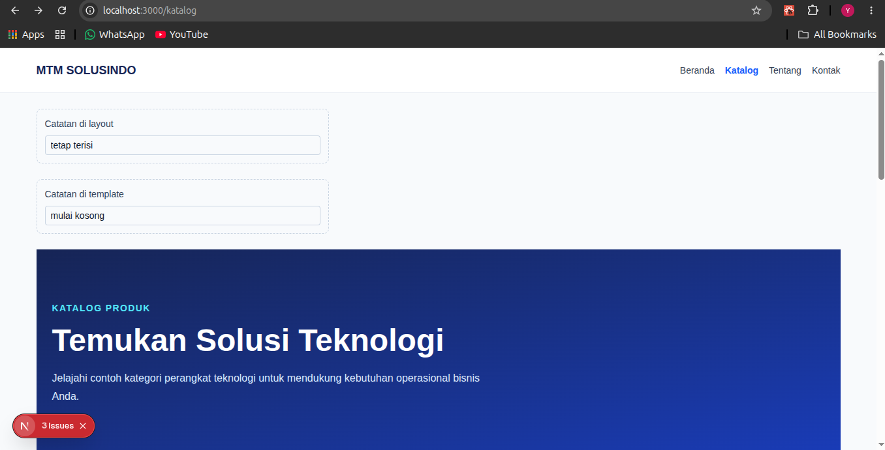
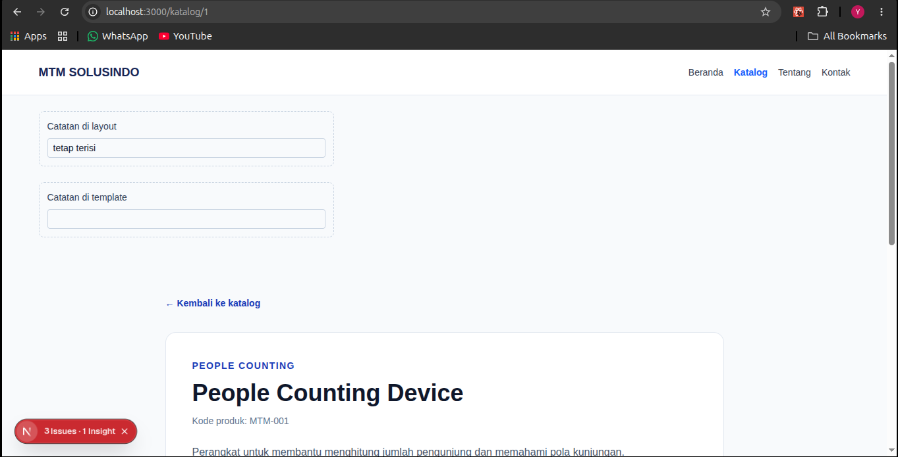
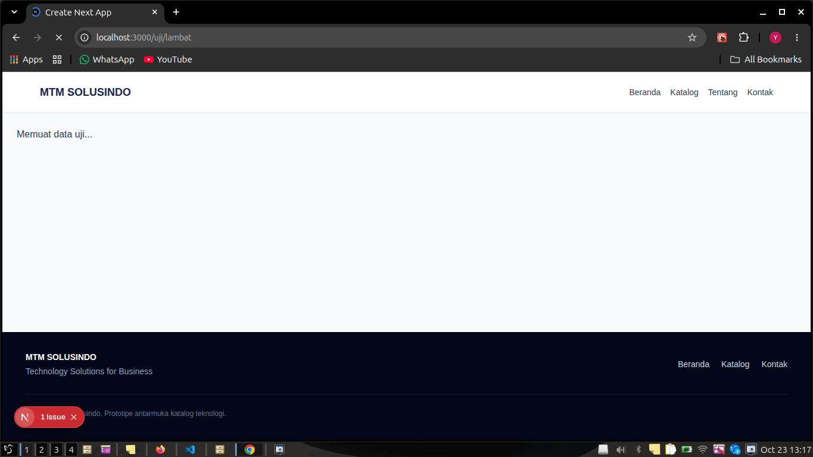
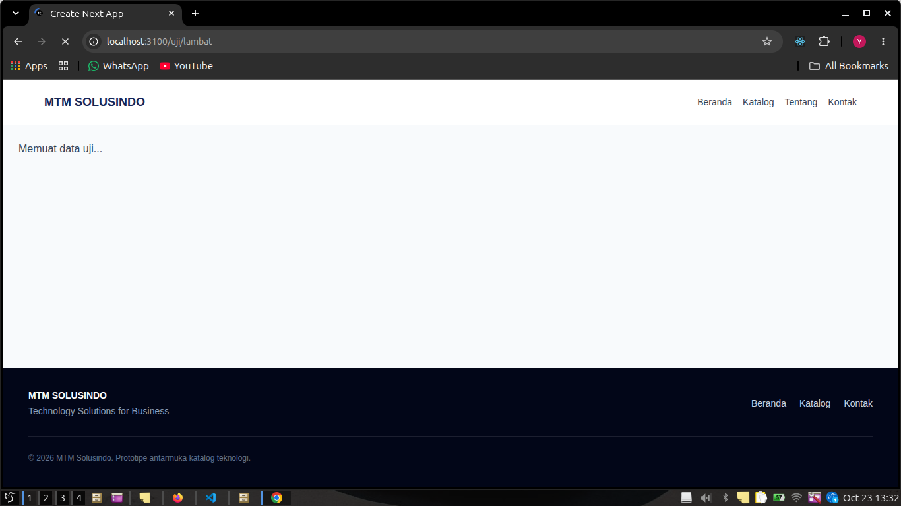
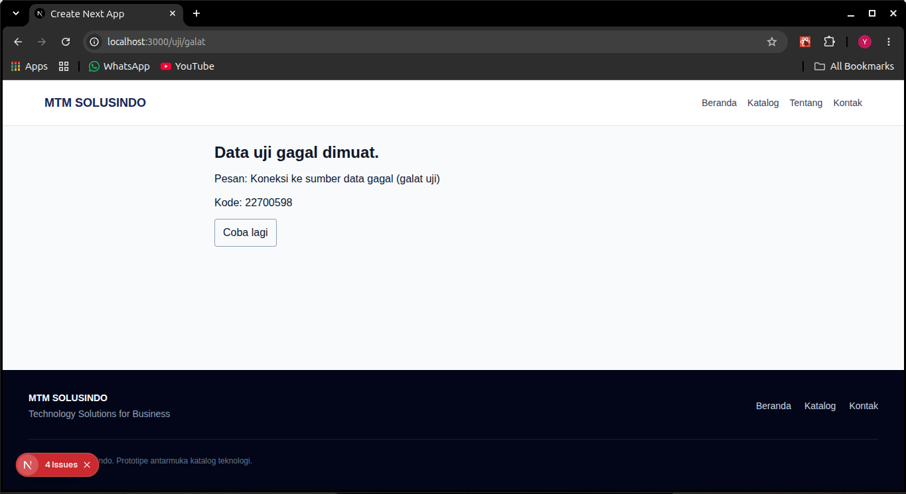
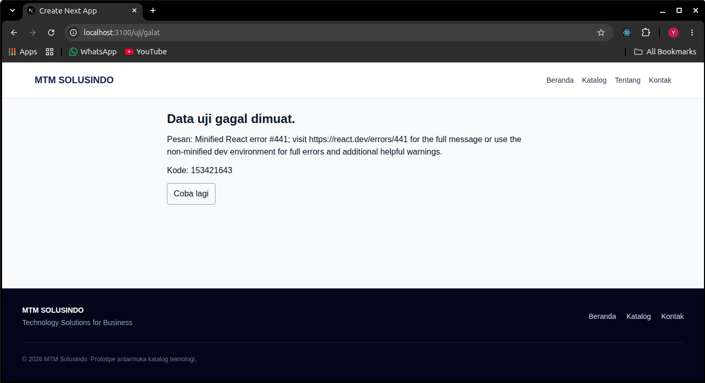

# Dokumen Teknis Modul 4: Next.js App Router

**Nama/NIM:** Yusuf Rizky Nugroho / 105224012  
**Repositori:** https://github.com/yusufrn1/Project-MTM-Solusindo  
**Branch:** week-4  
**Versi Next.js:** 16.4.0  
**Mode Cache Components:** Aktif  
**Partial Prefetching:** Aktif  

## 1. Peta Rute

### 1.1 Daftar Rute

| URL | File di `app/` | Jenis Rute | Isi Halaman |
|---|---|---|---|
| `/` | `app/page.tsx` | Statis | Halaman utama MTM Solusindo |
| `/katalog` | `app/katalog/page.tsx` | Statis | Daftar produk |
| `/katalog/[id]` | `app/katalog/[id]/page.tsx` | Dinamis | Detail produk berdasarkan ID |
| `/tentang` | `app/tentang/page.tsx` | Statis | Informasi tentang perusahaan |
| `/kontak` | `app/kontak/page.tsx` | Statis | Halaman kontak dan formulir |
| Rute tidak dikenal | `app/not-found.tsx` | Fallback | Pesan 404 dengan tautan kembali ke beranda |

### 1.2 Hasil Build

Perintah yang digunakan:

    npm run build

Hasil build produksi pada 23 Oktober 2026:

```text
Route (app)
┌ ○ /
├ ○ /_not-found
├ ○ /katalog
├   /katalog/[id]
│ ├ ◐ /katalog/[id]
│ ├ ○ /katalog/1
│ ├ ○ /katalog/2
│ └ ◐ [+4 more paths]
├ ○ /kontak
└ ○ /tentang
```

Keterangan:
- `○` menunjukkan konten statis yang dipra-render.
- `◐` menunjukkan Partial Prerender: HTML statis disiapkan bersama konten server yang dialirkan saat permintaan.
- `/_not-found` adalah entri fallback internal yang dicetak Next.js, bukan URL yang ditautkan dari aplikasi.
- `generateStaticParams()` menghasilkan enam ID produk; ringkasan build menampilkan dua ID pertama dan empat lainnya sebagai `+4 more paths`.

## 2. Layout, Template, dan Berkas Khusus

### 2.1 Struktur Folder `app/`

    app/
    ├── favicon.ico
    ├── globals.css
    ├── layout.tsx
    ├── page.tsx
    ├── not-found.tsx
    ├── katalog/
    │   ├── [id]/page.tsx
    │   ├── error.tsx
    │   ├── layout.tsx
    │   ├── loading.tsx
    │   ├── not-found.tsx
    │   ├── page.tsx
    │   └── template.tsx
    ├── kontak/page.tsx
    └── tentang/page.tsx

    components/
    ├── Button.tsx
    ├── CategoryCard.tsx
    ├── Footer.tsx
    ├── KolomCatatan.tsx
    ├── Navbar.tsx
    ├── ProductCard.tsx
    └── TautanNav.tsx

    lib/
    ├── crypto/product-integrity.ts
    └── data.ts

Route uji `/uji/lambat` dan `/uji/galat` sudah dihapus setelah pengambilan screenshot; gambar buktinya tetap ada di folder ini. Fixture pelanggaran `server-only` bernama `app/test-server-only/` juga telah dihapus setelah pengujian agar tidak menggagalkan build.

### 2.2 Pengujian Layout dan Template

Layout digunakan untuk mempertahankan elemen antarmuka ketika berpindah halaman dalam segmen yang sama. Template dibuat ulang ketika navigasi terjadi sehingga state dan efek di dalamnya dapat diinisialisasi kembali.

Isi kolom sebelum klik detail: `tetap terisi` pada catatan layout dan `mulai kosong` pada catatan template. Kedua kolom berada di bawah navbar.

**Hasil pengujian:** Saat berpindah dengan `Link` dari `/katalog` ke `/katalog/1`, kolom layout tetap terisi sedangkan kolom template pada halaman detail kosong. Screenshot sebelum dan sesudah perpindahan ditampilkan di bawah. Saat kembali ke `/katalog`, Next.js dapat memulihkan nilai katalog sebelumnya dari cache navigasi.

**Kesimpulan:** Layout mempertahankan state bersama saat pindah segmen. Template dipasang ulang untuk segmen detail sehingga state template pada halaman detail mulai kosong; ketika kembali, Next.js dapat memulihkan instance halaman katalog yang masih tersimpan di cache navigasi.

**Lampiran screenshot:**





`ss_struktur-folder.png` adalah tangkapan struktur lama dan perlu diperbarui setelah route uji dihapus.

### 2.3 Pengujian `loading.tsx`

`app/katalog/loading.tsx` menyediakan fallback berlabel `role="status"` ketika konten segmen katalog sedang menunggu.

**Hasil pengujian:** Route sementara `/uji/lambat` menunggu 2,5 detik dan menampilkan fallback `Memuat data uji...` dengan `role="status"`. URL diuji di dev dan produksi; screenshot fallback ditampilkan di bawah.

**Lampiran screenshot:**





### 2.4 Pengujian `error.tsx`

`app/katalog/error.tsx` adalah Client Component yang menerima `error` dan `reset`. Route error uji sementara menggunakan `retry()` sesuai Next.js 16.4, lalu dihapus setelah screenshot.

**Hasil pengujian:** Route sementara `/uji/galat` memicu error server. Di dev, boundary menampilkan pesan asli dan digest; di produksi, pesan generik React dan digest tampil. Screenshot kedua mode ditampilkan di bawah.

**Lampiran screenshot:**





## 3. Rute Dinamis dan Validasi `params`

### 3.1 Implementasi Rute Dinamis

Rute `app/katalog/[id]/page.tsx` menggunakan parameter dinamis `id` untuk menentukan produk yang ditampilkan.

Parameter `params` pada Next.js 16 berbentuk Promise sehingga perlu diambil menggunakan `await`.

Fungsi `generateStaticParams()` digunakan untuk menentukan ID produk yang dapat dipersiapkan saat proses build.

Screenshot `GenerateStaticParams.png` menunjukkan implementasi sebelumnya; validasi ID pada screenshot belum sama dengan implementasi terakhir, jadi perbarui jika digunakan sebagai bukti kode final.

### 3.2 Aturan Validasi

Validasi dilakukan untuk memastikan bahwa:
1. ID produk berupa bilangan bulat positif.
2. ID sesuai dengan produk yang tersedia.
3. ID tidak valid atau produk tidak ditemukan akan memanggil `notFound()`.

### 3.3 Tabel Pengujian Rute

| URL | Hasil yang Diharapkan | Hasil Aktual | HTTP Status |
|---|---|---|---|
| `/katalog/1` | Detail produk ditampilkan | People Counting Device tampil | 200 |
| `/katalog/2` | Detail produk ditampilkan | RFID Reader tampil | 200 |
| `/katalog/03` | Item tidak ditemukan | UI “Produk Tidak Ditemukan” dan `noindex` tampil | 200* |
| `/katalog/abc` | Item tidak ditemukan | UI “Produk Tidak Ditemukan” dan `noindex` tampil | 200* |
| `/katalog/999` | Item tidak ditemukan | UI “Produk Tidak Ditemukan” dan `noindex` tampil | 200* |
| `/tidak-ada` | Halaman tidak ditemukan | UI `app/not-found.tsx` dan `noindex` tampil | 404 |

Pemeriksaan dilakukan dengan `curl` ke server produksi pada `localhost:3100`. `*` Respons `200` untuk not-found katalog terjadi karena fallback dirender setelah streaming dimulai; respons tetap memuat metadata `noindex` dan UI not-found. Ini bukan bukti bahwa ID diterima sebagai produk.

## 4. Server Components vs Client Components

### 4.1 Perbandingan Komponen

| File/Komponen | Jenis | Alasan Teknis |
|---|---|---|
| `app/layout.tsx` | Server Component | Root layout, metadata, font, dan kerangka HTML tanpa state klien |
| `app/page.tsx`, `app/tentang/page.tsx` | Server Component | Konten halaman tanpa hook atau event handler |
| `app/katalog/page.tsx` | Server Component | Membaca daftar dari `lib/data.ts` dan merender daftar produk di server |
| `app/katalog/[id]/page.tsx` | Server Component | Meng-await `params`, memvalidasi ID, dan mencari data di server |
| `app/katalog/layout.tsx` | Server Component | Kerangka katalog persisten; hanya menyisipkan `KolomCatatan` klien |
| `app/katalog/template.tsx` | Server Component | Kerangka route yang dipasang ulang pada pergantian segmen |
| `app/katalog/loading.tsx`, `app/katalog/not-found.tsx`, `app/not-found.tsx` | Server Component | Fallback tampilan tanpa state browser |
| `app/katalog/error.tsx` | Client Component | Error boundary memakai `useEffect` dan tombol `reset()` |
| `app/kontak/page.tsx` | Client Component | Formulir memakai `useState` dan event handler |
| `components/TautanNav.tsx` | Client Component | `usePathname()` dan `aria-current` untuk rute aktif |
| `components/KolomCatatan.tsx` | Client Component | `useId`, `useState`, dan `onChange` untuk uji state |
| `components/Navbar.tsx`, `Footer.tsx`, `ProductCard.tsx`, `CategoryCard.tsx`, `Button.tsx` | Server Component | Presentasi/navigasi tanpa hook interaktif; dipakai dalam Server Component |

### 4.2 Penggunaan `server-only`

File `lib/data.ts` menggunakan:

    import "server-only";

Tujuannya adalah memastikan modul data tersebut hanya digunakan di lingkungan server.

**Pengujian:** `lib/data.ts` memuat `import "server-only"`. Import sementara dari Client Component menghasilkan build error yang menyebut modul tersebut tidak dapat diimpor dari Client Component. Route uji sementara `app/test-server-only/page.tsx` kemudian dihapus; membiarkannya ada menyebabkan `next build` gagal.

**Kesimpulan:** Penjagaan `server-only` aktif. Modul data hanya digunakan oleh halaman Server Component.

## 5. Verifikasi

Pengujian dilakukan menggunakan perintah berikut:

    npx tsc --noEmit
    npm run lint
    npm run build

### Hasil Pengujian

| Perintah | Hasil | Keterangan |
|---|---|---|
| `npx tsc --noEmit` | Berhasil | TypeScript tidak melaporkan error |
| `npm run lint` | Berhasil | ESLint selesai tanpa error atau warning |
| `npm run build` | Berhasil setelah retry | Build menghasilkan tabel route di atas; Next.js menampilkan advisori keamanan untuk versi `16.4.0` sebelum build selesai |

Typecheck dan lint berjalan bersih. Pada pemeriksaan build pertama, Next.js menghentikan proses untuk menampilkan peringatan keamanan; mengulangi `npm run build` menyelesaikan build. Versi terpasang tetap `16.4.0` dan perlu diperbarui ke versi aman.

## 6. Kendala dan Penyelesaian

### 6.1 Navigasi Internal dan lint

**Kendala:** Lint mendeteksi navigasi internal yang memakai elemen HTML `<a>`.

**Penyelesaian:** Mengganti tautan internal yang ditemukan dengan `Link` dari `next/link`. Pemeriksaan lint akhir berhasil.

### 6.2 Validasi Formulir Kontak

**Kendala:** Pemeriksaan lint mendeteksi pemanggilan `setState` di dalam `useEffect`.

**Penyelesaian:** Inisialisasi state formulir diubah menggunakan lazy initializer pada `useState`.

### 6.3 Batas Server-Client dan build

**Kendala:** Route uji `app/test-server-only` yang masih mengimpor `lib/data.ts` dari Client Component membuat build gagal, sebagaimana memang diharapkan dari `server-only`.

**Penyelesaian:** Route `app/test-server-only/` dihapus setelah pesan batas server-klien dicatat. Route uji `app/uji/` dihapus setelah screenshot loading/error dev dan produksi tersimpan. Build berhasil. Next.js juga mengeluarkan peringatan bahwa `16.4.0` terdampak advisori keamanan; pembaruan dependensi belum dijalankan.

## 7. Catatan Pemanfaatan AI

GitHub Copilot digunakan untuk meninjau implementasi App Router, memperbaiki navigasi internal, mengimplementasikan perilaku layout/template dan validasi `params`, menjalankan lint/typecheck/build serta pengujian URL, dan menyusun dokumentasi ini.

Hasil diverifikasi dengan `npx tsc --noEmit`, `npm run lint`, `npm run build`, `curl` pada server produksi, serta browser dev dan produksi untuk loading/error. Enam screenshot runtime sudah dilampirkan: layout-template sebelum/sesudah navigasi, loading dev/produksi, dan error dev/produksi.
EOF