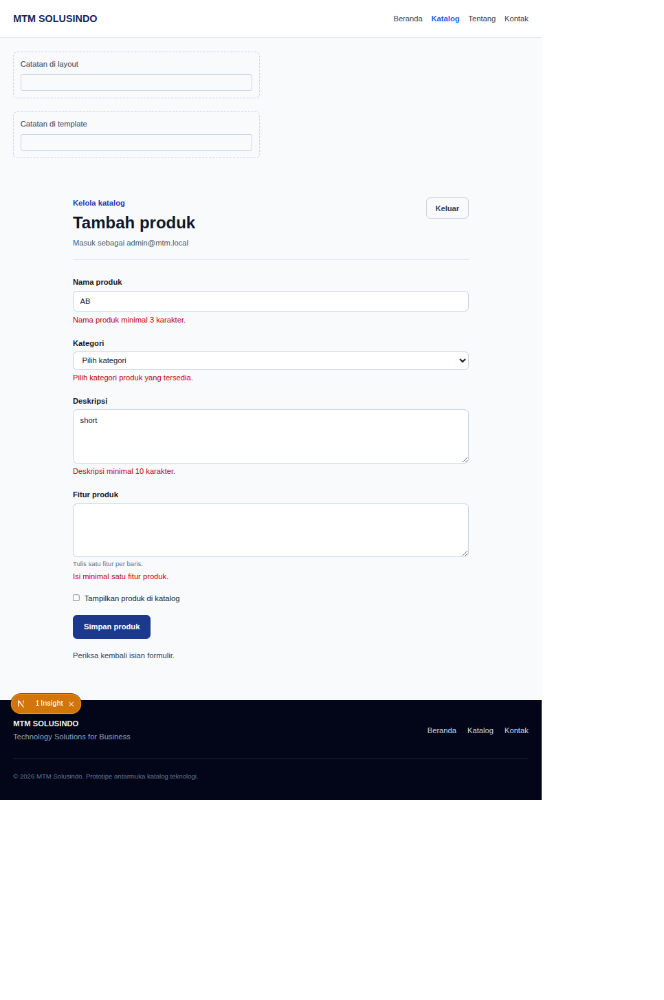
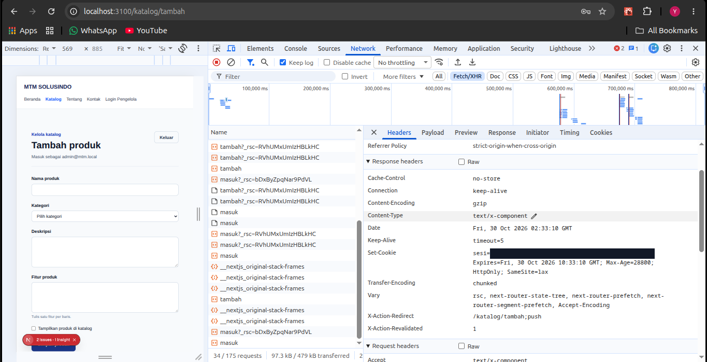
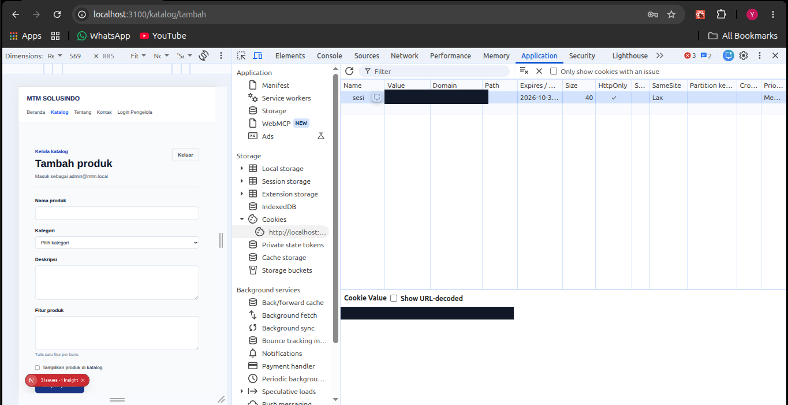
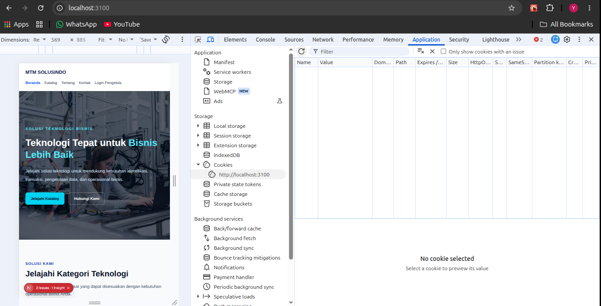
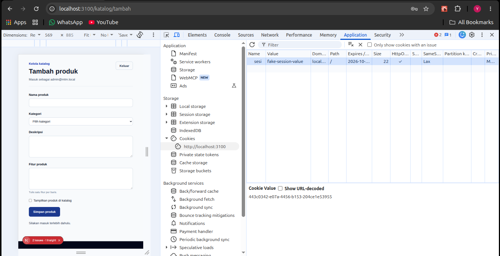
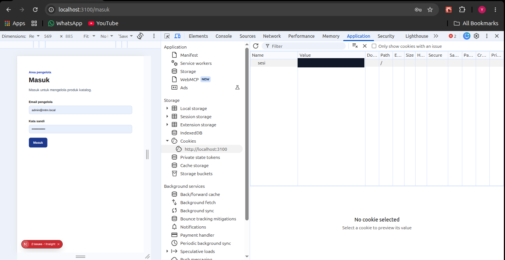

# Dokumen Teknis Modul 5 — Formulir, Validasi, Session, dan Cookie

**Nama/NIM:** Yusuf Rizky Nugroho / 105224012  
**Repositori:** https://github.com/yusufrn1/Project-MTM-Solusindo

> Implementasi ini adalah prototipe praktikum. Produk dan sesi disimpan dalam memori proses; akun pengelola demo bukan autentikasi produksi, dan alur checkout/pembayaran belum dibuat.

## 1. Skema Validasi

Skema produk berada di `lib/skema.ts` sebagai `skemaProduk` (Zod 4). Skema disusun dari model produk MTM Solusindo: nama, kategori, deskripsi, fitur, dan status tampil di katalog.

| Kolom | Aturan | Pesan/hasil |
|---|---|---|
| `name` | String dipangkas, 3–80 karakter | Nama produk minimal 3 karakter; maksimal 80 karakter |
| `category` | Salah satu kategori produk yang ditentukan | Pilih kategori produk yang tersedia |
| `description` | String dipangkas, 10–300 karakter | Deskripsi minimal 10 karakter; maksimal 300 karakter |
| `features` | String 3–500 karakter; satu fitur per baris, diubah menjadi array | Isi minimal satu fitur produk; daftar fitur maksimal 500 karakter |
| `aktif` | `z.stringbool().default(false)` | Checkbox dicentang menjadi `true`; tidak dikirim menjadi `false`; nilai palsu ditolak |

Halaman kontak tetap memakai `skemaKontak`, terpisah dari skema produk. Form kontak masih simulasi browser dan tidak mengirim data ke server.

Aturan semantik produk adalah nama tidak boleh sama dengan produk yang sudah ada. Aturan ini memerlukan data tersimpan, sehingga diperiksa di `app/katalog/actions.ts` setelah `safeParse` berhasil dan sebelum mutasi.

## 2. Alur Server Action

`simpanProduk` menjalankan pemeriksaan berurutan: sesi sah, `skemaProduk.safeParse`, keunikan nama, mutasi `tambahProduk`, `revalidatePath("/katalog")`, lalu `redirect` ke detail produk. `redirect` berada di luar blok `try` karena Next.js menggunakannya sebagai alur kontrol.

`FormProduk` adalah Client Component yang memakai `useActionState` untuk status pending, pesan umum, nilai formulir yang dikembalikan, dan galat per kolom. Galat dihubungkan melalui `aria-invalid` dan `aria-describedby`. Login juga memakai `useActionState`; halaman tambah produk dan detail produk adalah Server Components.

## 3. Bukti Uji Validasi

Perintah otomatis: `npm test`. Hasil terakhir: 4 berkas tes, 27 tes lulus.

Kasus penolakan skema produk (`tests/produk-validation.test.ts`):

| # | Masukan | Hasil yang diharapkan | Hasil otomatis |
|---|---|---|---|
| 1 | Nama kosong | Ditolak; nama wajib/minimum | Lulus |
| 2 | Nama 2 karakter | Ditolak; minimal 3 karakter | Lulus |
| 3 | Nama 81 karakter | Ditolak; maksimal 80 karakter | Lulus |
| 4 | Kategori tidak dikirim | Ditolak | Lulus |
| 5 | Kategori di luar pilihan | Ditolak | Lulus |
| 6 | Deskripsi kurang dari 10 karakter | Ditolak | Lulus |
| 7 | Deskripsi 301 karakter | Ditolak | Lulus |
| 8 | Fitur kosong | Ditolak | Lulus |
| 9 | Daftar fitur 501 karakter | Ditolak | Lulus |
| 10 | Nilai checkbox palsu (`maybe`) | Ditolak | Lulus |

Tiga pengiriman melalui UI dengan atribut `novalidate` sehingga validasi bawaan browser dilewati:

| # | Masukan | Hasil yang diharapkan | Hasil browser |
|---|---|---|---|
| 1 | Nama `AB`, kategori kosong, deskripsi `short`, fitur kosong | Galat tampil pada keempat kolom | Ditolak; semua galat kolom tampil |
| 2 | Nama `RFID Reader` yang sudah ada dan data lain valid | Galat semantik pada nama | Ditolak: nama sudah digunakan |
| 3 | Data produk valid selain fitur satu karakter (`x`) | Galat minimum fitur | Ditolak: fitur minimal 3 karakter |

Pengiriman produk valid juga diuji di browser: berpindah ke halaman detail dan produk muncul di katalog.

## 4. Session dan Cookie

Login demo menggunakan `DEMO_EMAIL` dan `DEMO_KATA_SANDI` dari `.env.local`; `.env.example` hanya berisi nama variabel tanpa nilai. Cookie `sesi` dibuat dengan `HttpOnly`, `SameSite=Lax`, `Path=/`, dan `Max-Age=28800` (8 jam). `Secure` aktif pada production dan nonaktif di localhost. Browser check setelah login menunjukkan `document.cookie` kosong.

Sesi disimpan di `Map` pada server dan dicabut saat logout. Tes `tests/session-store.test.ts` memeriksa ID hilang, ID palsu, sesi sah, kedaluwarsa, dan pemakaian ulang ID setelah logout. Browser check menunjukkan logout menghapus cookie, sementara cookie palsu ditolak oleh pemeriksaan sesi server.

**Header `Set-Cookie`**

Nilai session ID telah ditutup pada gambar; atribut cookie tetap terbaca.

**Application — atribut cookie**

**Logout menghapus cookie**

**Cookie palsu ditolak**

**Cookie lama setelah logout ditolak**

Cookie lama ditambahkan kembali setelah logout. Saat membuka `/katalog/tambah`, pemeriksaan sesi server menolak ID yang sudah dicabut dan mengarahkan browser ke `/masuk`. Nilai cookie disamarkan pada screenshot.

Jangan lampirkan nilai cookie asli, HAR, atau `.env.local`.

## 5. Keputusan Teknis

Pola session server dipilih agar logout dapat mencabut ID yang masih berada di cookie. `proxy.ts` hanya memeriksa keberadaan cookie sebagai pemeriksaan optimistik; halaman dan setiap Server Action tetap memvalidasi ID melalui `bacaSesi()`. Karena session store berupa `Map` lokal, sesi tidak dibagikan antar-instance dan hilang saat proses server dimulai ulang. Gunakan pustaka autentikasi dan penyimpanan persisten sebelum deployment nyata.

Produk baru juga hanya tersimpan di array dalam memori dan kembali ke data awal setelah proses dimulai ulang. Tidak ada akun pelanggan, checkout, stok nyata, harga, pesanan, atau payment gateway pada implementasi ini.

## 6. Kendala dan Penyelesaian

- Cache Components menolak pembacaan waktu selama prerender. Route tambah produk memakai `connection()` di dalam `<Suspense>` sebelum memeriksa masa berlaku sesi.
- Route detail membaca `params` secara dinamis. Konten detail ditempatkan di dalam `<Suspense>` agar shell dapat dirender tanpa blocking.
- Atribut HTML seperti `maxLength` membatasi input pengguna bahkan ketika `novalidate` dipasang. Batas maksimum tetap diuji langsung terhadap skema server.

## 7. Catatan Pemanfaatan AI

GitHub Copilot membantu menyusun skema, Server Actions, session demo, Proxy, tes, dan dokumen ini. Verifikasi dilakukan dengan `npx tsc --noEmit`, `npm run lint`, `npm test`, production build, serta uji browser untuk bypass validasi, tambah produk, logout, dan cookie palsu. Screenshot DevTools masih perlu diambil manual.