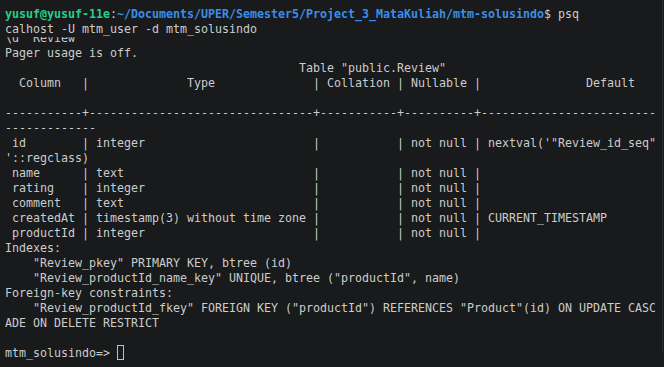
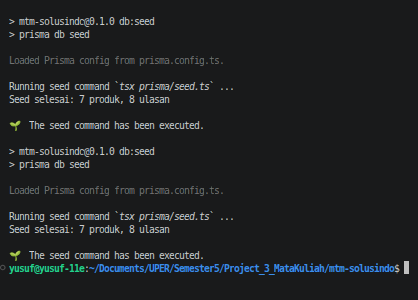
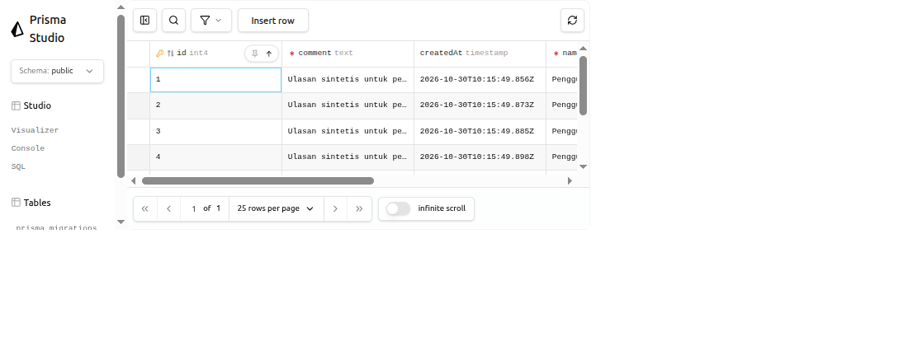
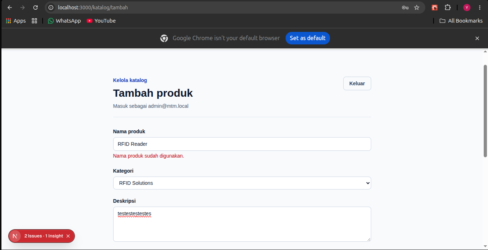
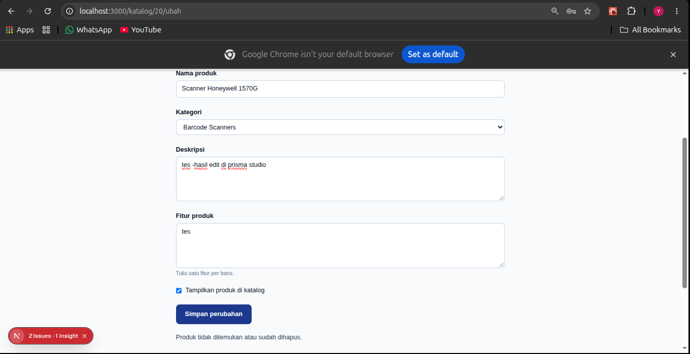
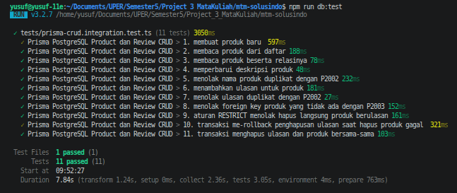

# Dokumen Teknis Modul 6 — PostgreSQL dan Prisma ORM

**Nama/NIM:** Yusuf Rizky Nugroho / 105224012  
**Repositori:** https://github.com/yusufrn1/Project-MTM-Solusindo  
**Branch kerja:** `week-6`

> Status pengerjaan: migrasi sudah diterapkan, Prisma Client berhasil dibuat, seed berhasil dijalankan dua kali dengan jumlah data yang sama, dan 11 tes integrasi PostgreSQL lulus. Tangkapan layar psql, Prisma Studio, P2002, P2025, dan tes rollback sudah disimpan. Jangan menaruh `.env` di Git atau mengirim kredensial ke chat.

Pemeriksaan yang berhasil dijalankan pada workspace: `npx prisma validate`, `npx prisma migrate status`, `npm run db:generate`, dua kali `npm run db:seed`, `npm run db:test`, `npx tsc --noEmit`, `npm run lint`, dan `npm test`. Hasil `npm run db:test`: 11/11 tes integrasi lulus. Hasil `npm test`: 34 tes lulus dan 11 tes integrasi dilewati karena perintah tersebut tidak mengaktifkan `RUN_DB_TESTS=1`.

### Status bukti untuk dilengkapi

- [x] Tangkapan layar struktur tabel `Review` dari `psql`: `docs/praktikum/postgreSQL_constraint.png`.
- [x] Keluaran seed pertama dan kedua dengan jumlah produk/ulasan yang sama: 7 produk dan 8 ulasan pada kedua eksekusi; tangkapan layar `docs/praktikum/2seed.png`.
- [x] Tangkapan layar data ulasan di Prisma Studio: `docs/evidence/modul-06-prisma-studio.png`.
- [x] Tangkapan layar pesan validasi nama produk duplikat (P2002): `docs/praktikum/nama_produk_sudah_digunakan.png`.
- [x] Tangkapan layar pesan produk tidak ditemukan (P2025): `docs/praktikum/produk_tidak_ditemukan_atau_sudah_dihapus.png`.
- [x] Hasil tes integrasi PostgreSQL: 11/11 lulus, termasuk kasus rollback.
- [x] Tangkapan layar hasil `npm run db:test` menunjukkan 11/11 tes lulus, termasuk rollback: `rollback.png`.
- [x] Hasil aktual untuk minimal 10 skenario pada Bagian 6.

## 1. Rancangan Data

| Entitas | Kolom utama | Relasi dan constraint |
|---|---|---|
| `Product` | `id`, `name`, `category`, `description`, `features`, `active`, `image`, `imageAlt`, `createdAt`, `updatedAt` | `id` primary key; `name` unik |
| `Review` | `id`, `name`, `rating`, `comment`, `createdAt`, `productId` | Foreign key ke `Product`; unik gabungan `(productId, name)` |

Relasi adalah satu produk ke banyak ulasan. `onDelete: Restrict` mencegah produk dihapus langsung saat masih memiliki ulasan; aksi penghapusan menjalankan penghapusan ulasan dan produk dalam satu transaksi.

```text
Product (1) -------- (0..*) Review
	id                         productId -> Product.id
	name UNIQUE                 UNIQUE(productId, name)
```

## 2. Skema dan Migrasi

Skema berada di `prisma/schema.prisma`. Generator Prisma 7 menulis client ke `generated/prisma`; koneksi adapter PostgreSQL dibuat sekali di `lib/prisma.ts`. Migration SQL awal ada di `prisma/migrations/20261030120000_init/migration.sql`. `npx prisma migrate status` melaporkan database up to date dengan satu migrasi.

Isi skema yang digunakan:

```prisma
generator client {
	provider = "prisma-client"
	output   = "../generated/prisma"
}

datasource db {
	provider = "postgresql"
}

model Product {
	id          Int      @id @default(autoincrement())
	name        String   @unique
	category    String
	description String
	features    String[] @default([])
	active      Boolean  @default(true)
	image       String?
	imageAlt    String?
	createdAt   DateTime @default(now())
	updatedAt   DateTime @updatedAt
	reviews     Review[]
}

model Review {
	id        Int      @id @default(autoincrement())
	name      String
	rating    Int
	comment   String
	createdAt DateTime @default(now())
	productId Int
	product   Product  @relation(fields: [productId], references: [id], onDelete: Restrict)

	@@unique([productId, name])
}
```

Potongan migrasi yang menunjukkan constraint utama:

```sql
CREATE UNIQUE INDEX "Product_name_key" ON "Product"("name");
CREATE UNIQUE INDEX "Review_productId_name_key" ON "Review"("productId", "name");
ALTER TABLE "Review" ADD CONSTRAINT "Review_productId_fkey"
	FOREIGN KEY ("productId") REFERENCES "Product"("id")
	ON DELETE RESTRICT ON UPDATE CASCADE;
```

Validasi skema berhasil: `npx prisma validate` menghasilkan `The schema at prisma/schema.prisma is valid`.

Urutan perintah Prisma yang digunakan:

```bash
npx prisma validate
npm run db:migrate
npm run db:generate
```

Pemeriksaan database mengonfirmasi foreign key `Review_productId_fkey` dengan `ON UPDATE CASCADE ON DELETE RESTRICT`. Tangkapan layar perintah `\d "Review"` tersedia di `docs/praktikum/postgreSQL_constraint.png`.



## 3. Seed dan Prisma Client

Data produk sintetis berada di `prisma/data-awal.ts`. Seed di `prisma/seed.ts` memakai upsert pada nama produk serta pasangan `(productId, name)` untuk ulasan sehingga dapat dijalankan ulang.

Seed memakai `upsert`: produk dicari berdasarkan nama unik, lalu ulasan berdasarkan pasangan unik `(productId, name)`. Karena itu, eksekusi ulang tidak membuat baris duplikat. Perintah yang perlu dijalankan setelah migrasi:

```bash
npm run db:seed
npm run db:seed
npm run db:studio
```

Hasil aktual dari dua kali `npm run db:seed`:

```text
Eksekusi seed pertama: Seed selesai: 7 produk, 8 ulasan
Eksekusi seed kedua:   Seed selesai: 7 produk, 8 ulasan
```



Tangkapan layar tabel `Review` di Prisma Studio tersimpan di `docs/evidence/modul-06-prisma-studio.png` dan menampilkan data ulasan dari database lokal.



## 4. Operasi CRUD

| Operasi | Lokasi | Operasi Prisma | Penanganan |
|---|---|---|---|
| Daftar produk | `app/katalog/page.tsx` | `product.findMany` | Hanya produk aktif |
| Detail produk dan ulasan | `app/katalog/[id]/page.tsx` | `product.findFirst` dengan relasi `reviews` | `notFound()` bila tidak ditemukan |
| Tambah produk | `app/katalog/actions.ts` | `product.create` | Zod; P2002 menjadi galat nama produk |
| Ubah produk | `app/katalog/actions.ts` | `product.update` | P2002 dan P2025 menjadi pesan aman |
| Hapus produk | `app/katalog/actions.ts` | `$transaction` berisi `review.deleteMany` dan `product.delete` | P2025 diarahkan kembali ke katalog |
| Tambah ulasan | `app/katalog/ulasan-actions.ts` | `review.create` | Zod; P2002 duplikat, P2003 produk tidak ada |
| Hapus ulasan | `app/katalog/ulasan-actions.ts` | `review.deleteMany` | Dibatasi dengan ID produk dan sesi pengelola |

Tangkapan layar P2002 tersedia di `docs/praktikum/nama_produk_sudah_digunakan.png` dan menampilkan pesan “Nama produk sudah digunakan.” Tangkapan layar P2025 tersedia di `docs/praktikum/produk_tidak_ditemukan_atau_sudah_dihapus.png` dan menampilkan pesan “Produk tidak ditemukan atau sudah dihapus.”





## 5. Transaksi dan Rollback

Aksi hapus produk menjalankan penghapusan ulasan lalu produk menggunakan `$transaction([...])`. Tes integrasi lulus untuk penghapusan langsung yang ditolak oleh RESTRICT, rollback ketika query kedua gagal, dan penghapusan atomik produk beserta ulasannya.

**Hasil aktual:** tes `10. transaksi me-rollback penghapusan ulasan saat hapus produk gagal` lulus. Setelah query kedua gagal dengan `P2025`, tes memastikan ulasan masih berjumlah 1. Tes `11. transaksi menghapus ulasan dan produk bersama-sama` juga lulus.

Tangkapan layar `rollback.png` menunjukkan keluaran `npm run db:test` dengan 11/11 tes lulus, termasuk tes rollback. Tes tersebut memeriksa jumlah ulasan tetap 1 setelah query kedua gagal; data uji dibersihkan setelah suite selesai.



## 6. Skenario Uji

Tes integrasi berada di `tests/prisma-crud.integration.test.ts` (11 skenario) dan dijalankan dengan `npm run db:test`.

| # | Skenario | Hasil yang diharapkan | Hasil aktual |
|---|---|---|---|
| 1 | Tambah produk sah | Produk tersimpan dan ID dibuat | Lulus |
| 2 | Baca daftar produk | Produk tersimpan muncul | Lulus |
| 3 | Baca produk beserta ulasan | Produk dan relasi terbaca | Lulus |
| 4 | Ubah deskripsi produk | Perubahan tersimpan | Lulus |
| 5 | Tambah produk dengan nama duplikat | P2002 ditolak | Lulus |
| 6 | Tambah ulasan | Ulasan tersimpan pada produk | Lulus |
| 7 | Nama pengulas sama pada produk yang sama | P2002 ditolak | Lulus |
| 8 | Ulasan dengan productId palsu | P2003 ditolak | Lulus |
| 9 | Hapus langsung produk berulasan | RESTRICT menolak penghapusan | Lulus |
| 10 | Query kedua transaksi gagal | Perubahan ulasan di-rollback | Lulus |
| 11 | Hapus produk beserta ulasan | Kedua entitas terhapus atomik | Lulus |

Hasil `npm run db:test`: 11/11 skenario lulus (100%). Target modul minimal 9 dari 10 skenario, sehingga ambang tercapai. `npm test` tanpa `RUN_DB_TESTS=1` menghasilkan 34 tes lulus dan 11 tes integrasi dilewati; hasil suite ini tidak menggantikan hasil `npm run db:test`.

## 7. Kendala dan Penyelesaian

- Sebelumnya koneksi lokal mengembalikan Prisma `P1000`; setelah koneksi diperbaiki, PostgreSQL 18.6 dapat diakses, migrasi berstatus up to date, seed dan tes integrasi berhasil. Jangan mencatat atau membagikan isi `DATABASE_URL`.
- Prisma 7 memakai `prisma.config.ts`, adapter `@prisma/adapter-pg`, dan perintah `generate`/`db seed` terpisah dari migrasi.
- `lib/data.ts` dan Server Components memakai query async; `connection()` menempatkan pembacaan basis data pada waktu request sesuai Cache Components Next.js.
- `.env` lokal tidak terlacak Git. Pastikan `prisma/migrations/` ikut ditambahkan saat perubahan disiapkan untuk commit; jangan commit `generated/prisma/`.

## 8. Catatan Pemanfaatan AI

GitHub Copilot membantu meninjau kode dan menyusun dokumentasi serta skenario verifikasi. Perintah yang dijalankan: `npx prisma validate` (berhasil), `npx prisma migrate status` (up to date), `npm run db:generate` (berhasil), `npm run db:seed` dua kali (masing-masing 7 produk dan 8 ulasan), `npm run db:test` (11/11 lulus), `npx tsc --noEmit` (berhasil), `npm run lint` (berhasil), dan `npm test` (34 lulus, 11 integrasi dilewati). Tangkapan layar seed tersimpan di `docs/praktikum/2seed.png`, PostgreSQL di `docs/praktikum/postgreSQL_constraint.png`, Prisma Studio di `docs/evidence/modul-06-prisma-studio.png`, P2002 di `docs/praktikum/nama_produk_sudah_digunakan.png`, P2025 di `docs/praktikum/produk_tidak_ditemukan_atau_sudah_dihapus.png`, dan hasil tes rollback di `rollback.png`.