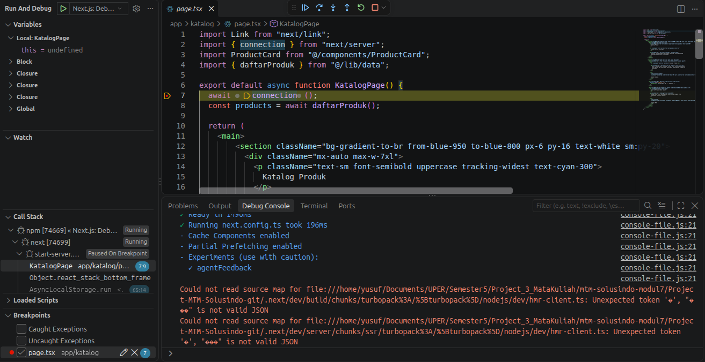
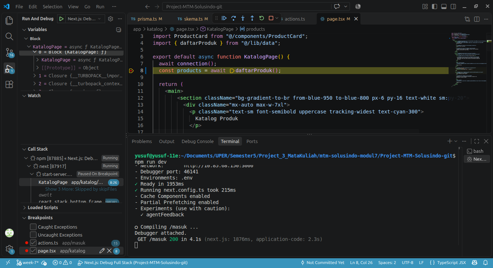
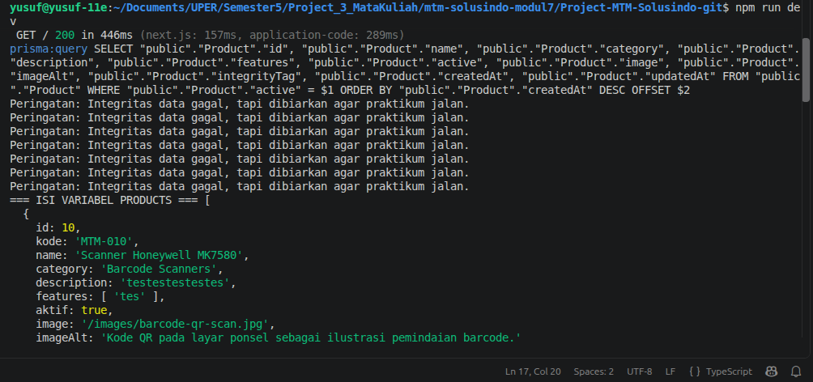
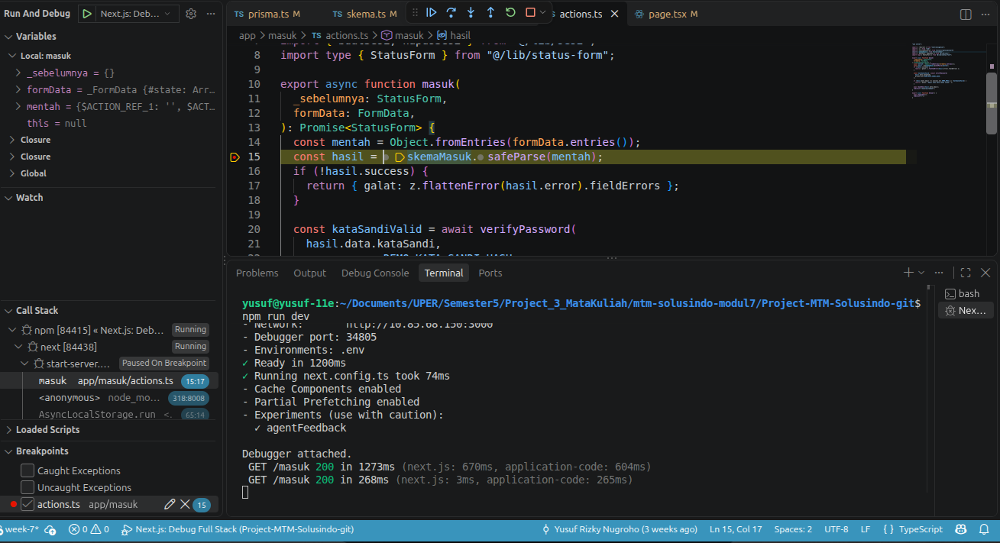

# Dokumen Teknis Modul 7 — Debugging dan Telaah Kode

**Nama/NIM:** Yusuf Rizky Nugroho / 105224012  
**Repositori:** https://github.com/yusufrn1/Project-MTM-Solusindo  
**Branch kerja:** `week-7`  
**Tanggal pengerjaan:** 27 November 2026

> Status: implementasi Product Integrity HMAC-SHA-256 dan perbaikan validasi checkbox telah dilakukan. Pengujian otomatis terakhir menghasilkan 65/65 tes lulus. Pemeriksaan TypeScript dan ESLint juga berhasil.

## 1. Lingkungan dan Konfigurasi Debugger

| Komponen | Versi/Konfigurasi |
|---|---|
| Sistem operasi | Lubuntu / Linux x64 |
| Node.js | v24.22.3 |
| npm | 11.19.1 |
| Visual Studio Code | 1.139.1 |
| Next.js | 16.4.1 |
| Prisma | 7.10.1 |
| PostgreSQL | 18.6 |
| Vitest | 3.2.7 |

Pemeriksaan versi dilakukan menggunakan `node -v`, `npm -v`, dan `code --version`.

### Konfigurasi debugger

Konfigurasi disimpan pada `.vscode/launch.json`, dengan tiga pilihan:

| Konfigurasi | Tipe | Fungsi |
|---|---|---|
| Next.js: Debug Server | `node-terminal` | Menjalankan dan melakukan debugging proses Next.js |
| Next.js: Debug Client | `pwa-chrome` | Debugging aplikasi melalui Chrome |
| Next.js: Debug Full Stack | `node-terminal` | Menjalankan server dan membuka Chrome melalui `serverReadyAction` |

Konfigurasi Prisma menggunakan `log: ["warn", "error"]` pada `lib/prisma.ts`. Query logging tidak diaktifkan.

### Bukti debugger Server Component

Breakpoint dipasang pada `app/katalog/page.tsx`, tepat sebelum pemanggilan `daftarProduk()`. Ketika halaman katalog dimuat ulang, debugger berhenti pada fungsi `KatalogPage`. Call Stack menunjukkan konteks Server Component yang sedang dieksekusi.



Bukti tambahan breakpoint pada baris pemanggilan data:



### Bukti debugger Server Action

Debugger juga digunakan pada `app/masuk/actions.ts`, pada proses validasi input login. Input uji yang valid secara struktur berhasil melewati `safeParse()`, tetapi verifikasi kata sandi menghasilkan `false` sehingga Server Action mengembalikan pesan kredensial salah. Ini merupakan pengamatan jalur eksekusi untuk kredensial tidak valid, bukan bug yang diklaim telah diperbaiki.





## 2. Daftar Galat dan Perbaikan

| No. | Issue | Gejala | Lapisan | Akar penyebab | Perbaikan |
|---|---|---|---|---|---|
| 1 | Validasi checkbox `aktif` | Nilai string tidak valid seperti `"maybe"` dapat dianggap `true`; field checkbox yang tidak dikirim tidak mengikuti perilaku default yang diharapkan | Validasi server / Zod | `z.coerce.boolean()` mengikuti konversi JavaScript `Boolean()`, sehingga string non-kosong seperti `"maybe"` menjadi `true` | Diganti menjadi `z.stringbool().default(false)` |
| 2 | Verifikasi integritas produk tidak menghentikan data invalid | Tag integritas yang tidak valid hanya menghasilkan peringatan dan alur pembacaan masih dapat berlanjut | Lapisan data / keamanan | Kegagalan verifikasi ditangani dengan `console.warn`, sementara `throw` dinonaktifkan | Mengaktifkan `throw new Error("Integritas data produk gagal diverifikasi.")` agar proses gagal secara tertutup |
| 3 | Jalur login dengan kredensial salah | `safeParse()` berhasil, tetapi autentikasi mengembalikan `kataSandiValid = false` dan pesan kredensial salah | Server Action autentikasi | Kredensial uji tidak cocok dengan hash/kredensial demo | Tidak dikategorikan sebagai bug; dicatat sebagai penelusuran jalur negatif untuk memastikan respons generik login |

## 3. Catatan Penelusuran

### 3.1 Validasi checkbox produk

**Lokasi:** `lib/skema.ts`, schema `skemaProduk`.

**Gejala dan reproduksi:**
1. Jalankan pengujian `npx vitest run tests/produk-validation.test.ts`.
2. Test mengirim nilai checkbox palsu `"maybe"`.
3. Test juga menguji formulir tanpa field checkbox.
4. Sebelum perbaikan, dua test gagal: nilai `"maybe"` diterima sebagai `true`, sedangkan field yang tidak dikirim tidak memenuhi ekspektasi test.

**Akar penyebab:** implementasi sebelumnya menggunakan:

```ts
aktif: z.coerce.boolean(),
```

`z.coerce.boolean()` menggunakan konversi boolean JavaScript. String `"maybe"` merupakan string non-kosong sehingga dapat dikonversi menjadi `true`.

**Perbaikan:**

```ts
aktif: z.stringbool().default(false),
```

Dengan perubahan ini, nilai string boolean dikenali secara eksplisit, nilai tidak valid ditolak, dan checkbox yang tidak dikirim menggunakan default `false`.

**Verifikasi setelah perbaikan:**

```bash
npx vitest run tests/produk-validation.test.ts
```

Hasil: **18/18 tes lulus**. Pengujian mencakup penolakan nilai checkbox palsu dan default `false` ketika checkbox tidak dikirim.

### 3.2 Verifikasi Product Integrity

**Lokasi:** `lib/data.ts` dan `lib/crypto/product-integrity.ts`.

**Gejala dan reproduksi berdasarkan telaah kode:** fungsi verifikasi integritas sebelumnya hanya menampilkan `console.warn` ketika tag tidak valid. Dengan demikian, kegagalan verifikasi belum menghentikan alur pembacaan data.

**Akar penyebab:** penanganan kegagalan verifikasi tidak bersifat fail-closed karena `throw` dikomentari.

**Perbaikan:**

```ts
if (!valid) {
  throw new Error("Integritas data produk gagal diverifikasi.");
}
```

Setelah perubahan, data dengan tag yang hilang atau tidak valid tidak diteruskan sebagai data produk yang lolos verifikasi.

**Verifikasi yang telah dilakukan:**

```bash
npx vitest run tests/crypto/product-integrity.test.ts
```

Hasil: **6/6 tes lulus**, termasuk verifikasi data asli, penolakan data yang diubah, format tag tidak valid, payload kosong, dan kunci berbeda.

Catatan: enam tes tersebut menguji fungsi kriptografi. Pengujian terpisah yang secara langsung mem-mock jalur baca `lib/data.ts` belum ditambahkan.

### 3.3 Penelusuran Server Action login

**Lokasi:** `app/masuk/actions.ts`.

**Langkah penelusuran:**
1. Breakpoint dipasang pada proses `skemaMasuk.safeParse(mentah)`.
2. Form login diuji dengan input yang valid secara struktur.
3. Debugger menunjukkan `hasil.success = true`.
4. Proses verifikasi kata sandi menghasilkan `kataSandiValid = false`.
5. Server Action mengembalikan pesan generik bahwa email atau kata sandi salah.

Kasus ini menunjukkan alur penolakan kredensial berjalan sebagaimana mestinya. Tidak ada perubahan kode yang diklaim sebagai perbaikan untuk kasus ini.

## 4. Keputusan Teknis

| Topik | Keputusan | Alasan |
|---|---|---|
| Validasi boolean dari formulir | Menggunakan `z.stringbool().default(false)` | Menghindari konversi sembarang string non-kosong menjadi `true` dan memberi default `false` pada checkbox yang tidak dikirim |
| Penghapusan produk dan ulasan | Menggunakan transaksi Prisma untuk menghapus ulasan terkait dan produk | Menjaga konsistensi operasi penghapusan |
| Pengubahan/penghapusan ulasan | Server Action memeriksa sesi dan mengikat operasi pada ID produk serta ID ulasan | Membatasi operasi sesuai konteks data dan hak akses |
| Nilai turunan pada UI | Nilai yang dapat dihitung dari data yang sudah ada sebaiknya tidak disimpan sebagai state duplikat | Menghindari state yang tidak sinkron |
| Penanganan error | Server Action mengembalikan error operasional/validasi yang dapat ditangani; error render yang tidak tertangani diteruskan ke error boundary | Memisahkan kesalahan input/operasi dari kegagalan rendering |

### Penghapusan produk yang memiliki ulasan

Implementasi menggunakan `prisma.$transaction()` untuk menghapus ulasan berdasarkan `productId`, kemudian menghapus produk. Pendekatan ini dipilih agar dua operasi database tersebut dijalankan sebagai satu transaksi.

### Penanganan error

`app/katalog/error.tsx` menyediakan UI pemulihan untuk error rendering pada segmen katalog. Server Action tetap menangani kondisi operasional yang diketahui, misalnya validasi gagal atau produk tidak ditemukan, dengan respons yang sesuai.

## 5. Telaah Kode dan Code Review

Perubahan kode dikerjakan dan diverifikasi pada branch `week-7`. Pada saat dokumentasi ini disusun, bukti Pull Request partner, minimal tiga komentar review, serta respons terhadap komentar belum tersedia untuk dicantumkan.

| Kategori | Temuan/komentar | Tindak lanjut |
|---|---|---|
| Pull Request partner | Belum ada bukti PR partner yang dapat diverifikasi | Belum dapat dicantumkan |
| Komentar review 1 | Belum tersedia | Belum dapat dicantumkan |
| Komentar review 2 | Belum tersedia | Belum dapat dicantumkan |
| Komentar review 3 | Belum tersedia | Belum dapat dicantumkan |
| Komentar yang diterima/ditolak | Belum tersedia | Belum dapat dicantumkan |

Bagian ini perlu dilengkapi dengan tautan PR dan komentar review yang benar-benar terjadi. Tidak ada komentar atau persetujuan reviewer yang direkayasa dalam laporan ini.

## 6. Kendala dan Penyelesaian

1. **Environment pengujian HMAC.** Pengujian Server Action membutuhkan `PRODUCT_INTEGRITY_KEY`. Pengujian menyediakan kunci khusus melalui `vi.stubEnv`, tanpa menampilkan kunci rahasia.
2. **Sinkronisasi migrasi Prisma.** Catatan migrasi database sudah ada, tetapi direktori migrasi belum tersedia pada branch kerja. File migrasi dipulihkan dari proyek sumber dan checksum diverifikasi. Pemeriksaan berikutnya menunjukkan database up to date.
3. **Tipe root layout.** Ketidaksesuaian tipe `children` pada root layout diselesaikan menggunakan `ReactNode`.
4. **Validasi checkbox.** Dua test gagal akibat penggunaan `z.coerce.boolean()`. Schema diperbaiki menjadi `z.stringbool().default(false)` dan 18 test validasi kembali lulus.
5. **Penegakan Product Integrity.** Kegagalan verifikasi sebelumnya hanya menghasilkan peringatan. Penanganan diubah menjadi exception agar data yang gagal diverifikasi tidak diteruskan.

## 7. Catatan Pemanfaatan AI

ChatGPT digunakan sebagai asisten untuk:
- Membantu menganalisis kegagalan pengujian.
- Meninjau implementasi HMAC dan validasi kunci.
- Mengidentifikasi penyebab kegagalan test checkbox.
- Memberikan arahan pemeriksaan migrasi Prisma.
- Membantu menyusun dan merapikan dokumentasi teknis.

Saran dan perubahan dari AI diperiksa serta dijalankan pada workspace lokal. Pengujian dan pemeriksaan akhir dilakukan pada proyek lokal.

Perintah verifikasi yang dijalankan:

```bash
npx vitest run tests/crypto/product-integrity.test.ts
npx vitest run tests/produk-validation.test.ts
RUN_DB_TESTS=1 npm test
npx tsc --noEmit
npm run lint
npx prisma migrate status
```

Hasil pemeriksaan terakhir:
- Vitest: **9 test files passed, 65 tests passed**.
- TypeScript `npx tsc --noEmit`: selesai tanpa output error.
- ESLint `npm run lint`: selesai tanpa output error.
- Prisma migration: sebelumnya menunjukkan `Database schema is up to date!`.

## 8. Ringkasan Bukti

| No. | Bukti | Status |
|---|---|---|
| 1 | Konfigurasi `.vscode/launch.json` | Tersedia di repository |
| 2 | Versi environment pengembangan | Dicatat |
| 3 | Screenshot debugger Server Component | Disertakan di atas |
| 4 | Screenshot debugger Server Action | Disertakan di atas |
| 5 | Pengujian HMAC | 6/6 lulus |
| 6 | Pengujian validasi produk | 18/18 lulus |
| 7 | Pengujian keseluruhan | 65/65 lulus |
| 8 | Pemeriksaan TypeScript | Lulus |
| 9 | Pemeriksaan ESLint | Lulus |
| 10 | Status migrasi Prisma | Up to date pada pemeriksaan sebelumnya |
| 11 | Bukti tiga error trace terpisah | Sebagian; dua temuan perbaikan dan satu jalur login negatif dijelaskan |
| 12 | Bukti code review partner dan komentar PR | Belum tersedia |

---

**Catatan akhir:** gambar pada dokumen menggunakan path relatif ke file Markdown. Simpan file ini di direktori `docs/praktikum/` yang sama dengan file PNG agar gambar tampil pada preview VS Code dan GitHub.
